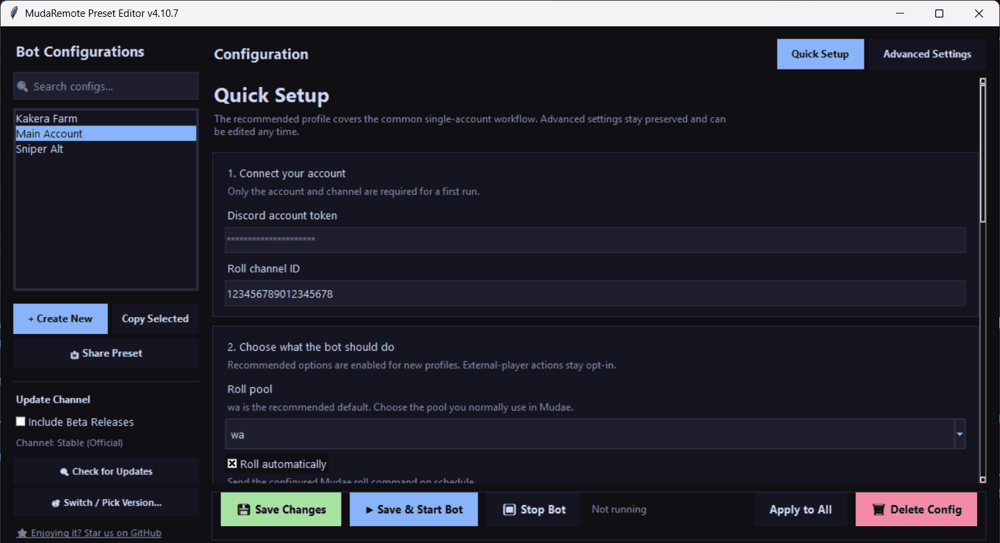

<p align="center">
  

  <h1 align="center">MudaFork</h1>

  <p align="center">
    A personal fork of MudaRemote, the Mudae automation app
  </p>
</p>

<p align="center">
  
</p>

---

> [!WARNING]
> Automating a user account (a self-bot) is against Discord's Terms of Service and can get the account banned.

MudaFork is a fork of [MudaRemote](https://github.com/misutesu-desu/MudaRemote) (MIT, Copyright (c) 2025 Mystes). The original license is kept in [LICENSE](LICENSE). MudaFork updates only from its own releases at [YoRu72/MudaPersonalFork](https://github.com/YoRu72/MudaPersonalFork).

## What the fork adds

- Side rolls and gives
- Automatic perk 10 upgrade
- Fast setup: pick your goals in **Quick Setup**, then press **Save & Start Bot**
- Logs: one line shape with kinds and redaction, daily TXT files, filters and export
- Keep running: the Android app asks for the phone settings that stop background apps from killing the bot

## Install

**Windows:** download `MudaFork.exe` from the [latest release](https://github.com/YoRu72/MudaPersonalFork/releases/latest), put it in its own folder and open it.

**Android:** download `MudaFork-<version>.apk` from the same release page and install it. It uses its own app id (`com.mudafork.android`), so it can stay next to the original MudaRemote app. Details are in [android/README.md](android/README.md).

**From source:**

```
git clone https://github.com/YoRu72/MudaPersonalFork.git
cd MudaPersonalFork
python -m pip install -r requirements.txt
python mudae_preset_editor.py
```

If a release has not been published yet, MudaFork finds no update and keeps running the version you have.

## License

MIT. See [LICENSE](LICENSE).
